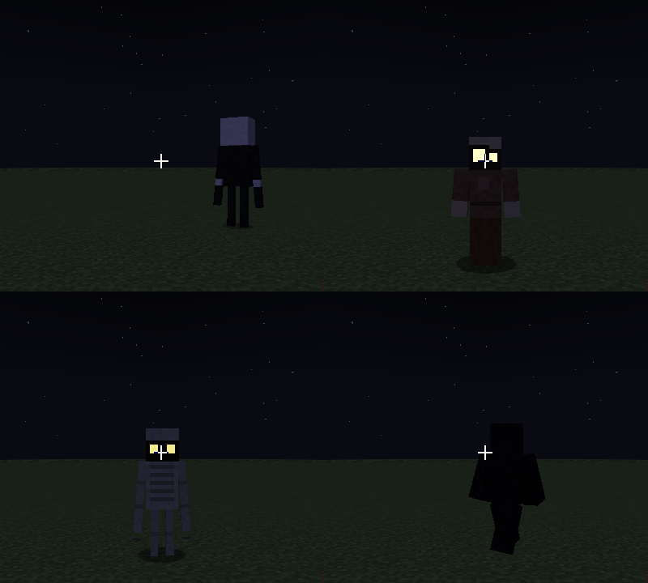
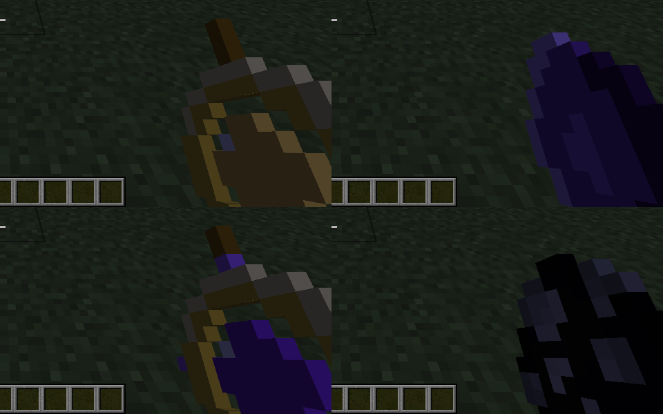

# Horror Entities（恐怖实体）

**Minecraft 1.21.1 · Forge 52.1.x · Java 21**

五种恐怖实体 + 一个决定"什么时候该出事"的恐惧导演系统。设计依据是对 Herobrine、Entity 303、Null 等 Minecraft 恐怖传说，
以及社区恐怖模组（The Only One、Shadow Stalker、Umbral Hunt 等）共同特征的调研，见下文。

> 本模组最初是 1.12.2 + Legacy Fabric 版本（git 提交 `6fb5449`），现已整体迁移并重写为 1.21.1 Forge（官方 Mojang 映射）。

## 调研：恐怖实体的共同特征

| 共同特征 | 在本模组中的体现 |
| --- | --- |
| **"被注视"是核心机制**——你看它，它就不动/消失；你移开视线，它靠近 | Stalker 被注视时完全冻结；Hollow 被盯 2.5 秒即消失 |
| **在视野边缘窥视**，保持距离，不像普通怪那样直冲过来 | Hollow 站在 26–40 格外的视线内；Stalker 从 30+ 格外悄悄逼近 |
| **瘦长、不自然的人形 + 发白光的眼睛** | 细长四肢的模型，所有实体的眼睛用全亮度叠加层渲染（像末影人） |
| **伪装与"不对劲"的声音** | Mimic 模仿牛、猪、村民的叫声，但音调偏低偏慢 |
| **心理恐怖多于战斗**：假聊天、故障、诡异音效、沉默 | 假的 "Herobrine 加入了游戏"、低语聊天、背后的脚步声、被熄灭的火把 |
| **黑暗/夜晚是它们的领地**，光是弱点 | Shade 在光照 ≥ 8 时灼烧，怕手持火把；Gaunt 怕阳光 |
| **逐步升级**，越久越糟 | 恐惧值（0–100）随黑暗上升，越高事件越频繁、越严重 |
| **有对策**，不是无解 | 守护符、火把、打破视线、日光 |

## 实体

| 实体 | 行为 |
| --- | --- |
| **潜行者 The Stalker** | 2.7 格高的沉默人影。被任何玩家注视时**无法移动也无法攻击**；移开视线后逼近，偶尔"瞬移式"跳近几格；靠近时有心跳声；被盯太久会消失；一旦得手只攻击一次（致盲+缓慢+尖叫）然后消失 |
| **空洞之影 The Hollow One** | 白眼人形，**无害且不可被伤害**。远远站着看你；你看它、靠近它、打它，它都会消失；偶尔留下"下界岩 + 红石火把"的痕迹（可在配置里关闭） |
| **拟态者 The Mimic** | 静止不动，模仿动物/村民叫声引诱你；你走近 9 格内它才暴露本性，尖叫并高速冲刺 |
| **瘦骨者 The Gaunt** | 夜间猎手：快、会扑、爪子长；**怕阳光**（白天着火） |
| **暗影 The Shade** | 只在黑暗中存在的剪影。光照 ≥ 8 会灼烧它；不敢靠近手持火把/灯笼/荧石/海晶灯/南瓜灯/菌光体的人；会悄悄熄灭附近火把；攻击附带虚弱+失明 |

所有实体都有刷怪蛋，并在创造模式物品栏 **Horror Entities** 标签页中。击杀（Hollow 除外）可掉落**梦魇碎片**。

## 恐惧导演（Dread Director）

主世界中，每个生存模式玩家都有 0–100 的**恐惧值**：夜晚、黑暗、地下会上升；白天和亮处会下降；附近有恐怖实体时额外上升。
恐惧值越高，事件越频繁、越严重：

| 恐惧值 | 可能发生 |
| --- | --- |
| ≥ 8 | 背后的脚步声、远处的开门声、洞穴音效、幽灵呻吟、箱子开合 |
| ≥ 20 | Hollow 出现在远处视线里；假聊天 |
| ≥ 30 | Shade 在黑暗处出现 |
| ≥ 35 | 附近的火把被悄悄熄灭（掉落为物品） |
| ≥ 40 | Stalker 出现 |
| ≥ 45 | Mimic 出现 |
| ≥ 55 | Gaunt 在夜间出现 |

## 物品

* **守护符 Warding Charm**：金锭 + 4 荧石粉（十字摆放）。**拿在手上**时恐怖实体不会以你为目标，恐惧值增长降低 75%、并缓慢下降。
  附近有恐怖实体时每 2 秒消耗 1 点耐久（80 点）。
* **高阶守护符 Greater Warding Charm**：1 个守护符 + 4 个梦魇碎片（无序合成），400 点耐久。
* **梦魇碎片 Nightmare Shard**：材料。

## 命令（需要 OP，权限等级 2）

```
/horror dread [数值]                     查看/设置自己的恐惧值
/horror spawn <实体> [距离]              在面前生成 stalker|hollow|mimic|gaunt|shade
/horror event <ambient|chat|torch>       立即触发一个导演事件
/horror clear                            清除所有已加载的恐怖实体
```

## 配置

首次启动生成 `config/horrorentities-common.toml`：

| 键 | 默认 | 说明 |
| --- | --- | --- |
| `enableDirector` | `true` | 总开关；关闭后只剩手动生成的实体 |
| `dreadGainMultiplier` | `1.0` | 恐惧值增长倍率 |
| `eventFrequency` | `1.0` | 事件频率倍率 |
| `enableFakeChat` | `true` | 假的加入/退出游戏与低语聊天 |
| `enableAmbientSounds` | `true` | 环境惊吓音效 |
| `enableTorchSnuffing` | `true` | 导演事件与 Shade 会熄灭火把（掉落为物品，不会销毁） |
| `enableTraces` | `true` | Hollow 留下下界岩+红石火把 |
| `maxEntitiesPerPlayer` | `2` | 每名玩家附近同时存在的恐怖实体上限 |

## 截图

在 Xvfb + Mesa 软件渲染下用真实 1.21.1 客户端连开发服务器截取（均为夜晚）：

| | |
| --- | --- |
|  |  |

左：潜行者（背面）、拟态者、瘦骨者、暗影——眼睛在黑暗中发光；右：手持物品的模型与贴图。

## 构建与测试

需要 JDK 21。

```bash
./gradlew build                # 产物：build/libs/horrorentities-2.0.0.jar
./gradlew runClient            # 开发客户端
./gradlew runServer            # 开发服务端（先在 run/eula.txt 写入 eula=true）
./gradlew runGameTestServer    # 行为测试（见下）
python3 tools/generate_textures.py   # 重新生成全部贴图（需要 Pillow）
```

`runGameTestServer` 使用 Forge GameTest 在真实服务端里跑 13 个行为测试：潜行者冻结/逼近/单次攻击后消失、
空洞之影被注视消失与无敌、拟态者休眠与暴露、瘦骨者锁定玩家与守护符驱散、日光灼烧、暗影怕光与手持火把、
掉落、配方加载、导演 API（恐惧值、熄灯、生成、清除）、命令生成的实体朝向玩家。测试代码在 `com.horrorentities.gametest`，不会打进发布的 jar。

说明：

* 所有贴图由 `tools/generate_textures.py` 程序化生成，没有外部素材。声音复用原版音效（调整音调），不含自定义音频。
* 本模组不注入自然刷怪表：全部实体由导演系统或命令生成，因此不会与其他模组的刷怪逻辑冲突。
* `build.gradle` 末尾把资源输出目录合并到类目录：在本构建环境中，FML 在开发运行时只扫描 `MOD_CLASSES` 的第一个条目，
  不合并就找不到 `@Mod` 类。对发布的 jar 没有影响。

## 安装

1. 安装 Minecraft 1.21.1 的 Forge（52.1.x）。
2. 把 `horrorentities-2.0.0.jar` 放进 `mods/`。
3. 服务端与客户端都需要安装本模组。

## 调研来源

* [Herobrine（Wikipedia）](https://en.wikipedia.org/wiki/Herobrine)
* [Minecraft Entity 303 – Herobrine（USC Folklore）](https://folklore.usc.edu/minecraft-entity-303-herobrine/)
* [The Only One（moddex）](https://moddex.gg/mod/the-only-one)：计算玩家是否在看它
* [Umbral Hunt Story（modpackindex）](https://www.modpackindex.com/modpack/155322/umbral-hunt-story)：突然出现/消失、心跳与低语
* [Shadow Stalker（modbay）](https://modbay.org/mods/6302-shadow-stalker.html)：视线被阻挡会中断追击、追逐音乐
* [LC Stalkers（modbay）](https://modbay.org/mods/25.70/mobs/)：只在玩家移开视线时前进的凝视型生物
