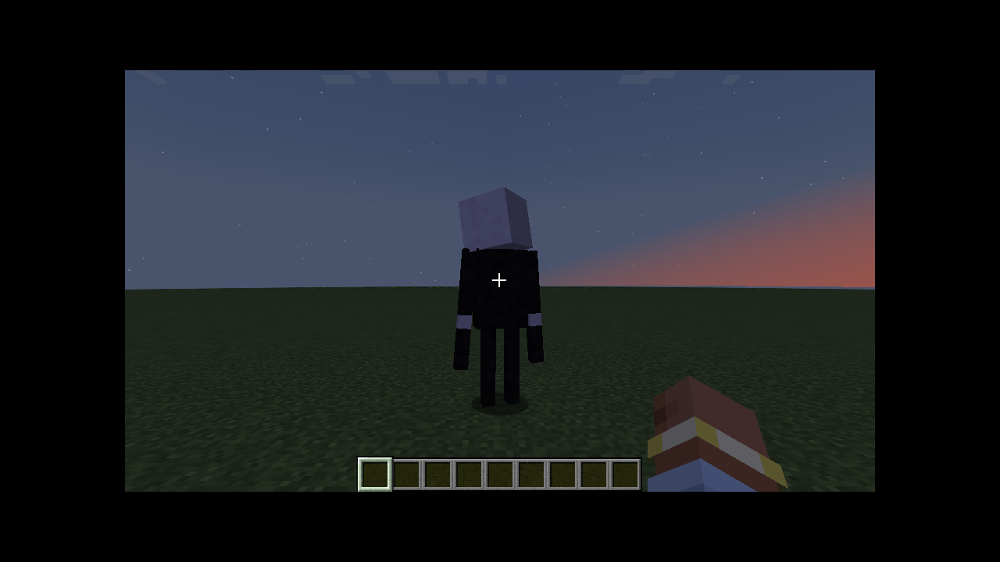

# Horror Entities（恐怖实体）

**Minecraft 1.21.1 · Forge 52.1.x · Java 21**

一个模组、**一个**恐怖实体：**潜行者（The Stalker）**。它从第二个夜晚起出现在你身边，不停地在周围晃，
靠近时你睡不了觉；它能被打死，但很难。世界里同一时间最多只有一个。

设计依据是 Herobrine、Entity 303、Null 等 Minecraft 恐怖传说以及社区恐怖模组的共同特征：被注视就静止、
在视野边缘窥视、瘦长人形加发光眼睛、沉默、以及"有对策"。

> 历史：最初是 1.12.2 + Legacy Fabric 的五实体版本（提交 `6fb5449`），后迁移到 1.21.1 Forge（`cb0e3b2`），
> 再精简为只有潜行者（本版本）。

## 潜行者

| | |
| --- | --- |
| **何时出现** | 从第 2 个夜晚开始（`firstNight` 可配置），天黑约 15 秒后出现在随机一名生存玩家周围 24–34 格处。每个夜晚只出现一次：被打死后当晚不会再来，下一个夜晚再次出现；天亮时自动消失 |
| **在周围晃** | 平时绕着你转圈，保持在 10–22 格，不时停下来盯着你；你跑远了它会瞬移追上 |
| **被注视时** | 完全冻结，不能移动也不能攻击。盯着它太久（约 8 秒，距离 > 8 格）它会瞬移到别处；它在 12 格内被盯久了，你会短暂失明并减速 |
| **未被注视时** | 偶尔瞬移式地靠近几格，20 格内有心跳声 |
| **攻击** | 每隔一段时间（默认 90 秒，`attackCooldownSeconds`）才出手一次：致盲 + 缓慢 + 尖叫，然后立刻瞬移走，继续晃 |
| **无法睡觉** | 它在 32 格内（`sleepBlockRange`）时，你无法上床；已经睡着的人会被惊醒。手持守护符不受影响 |
| **很难杀死** | 160 点生命、高护甲与韧性、免疫击退；单次伤害最多按 8 点计；被打后不到几秒就会再生；约三分之一的命中会让它瞬移闪开。但它能被杀死，死后掉落 3–5 个梦魇碎片 |
| **只能有一个** | 世界里同时最多一个；再生成（命令、`/summon`）会被拒绝 |

没有恐惧值系统，没有其他实体，也没有假聊天、环境音这类额外事件。

## 物品

* **守护符 Warding Charm**：金锭 + 4 荧石粉（十字摆放）。**拿在手上**时潜行者不会以你为目标，你也可以正常睡觉。
  潜行者在 10 格内时每 2 秒消耗 1 点耐久（80 点）。
* **高阶守护符 Greater Warding Charm**：1 个守护符 + 4 个梦魇碎片（无序合成），400 点耐久。
* **梦魇碎片 Nightmare Shard**：材料，击杀潜行者获得。
* **潜行者刷怪蛋**：创造模式物品栏 **Horror Entities** 标签页。

## 命令（需要 OP，权限等级 2）

```
/horror spawn [距离]    在面前生成潜行者（已存在则拒绝）
/horror clear           清除潜行者
/horror status          显示第几天、是否夜晚、潜行者数量、上次出现的日子
```

## 配置

首次启动生成 `config/horrorentities-common.toml`：

| 键 | 默认 | 说明 |
| --- | --- | --- |
| `firstNight` | `2` | 潜行者第一次出现在第几个夜晚（1 = 第一晚） |
| `sleepBlockRange` | `32.0` | 潜行者在此范围内时玩家无法睡觉 |
| `attackCooldownSeconds` | `90` | 两次攻击之间的间隔（秒，实际略有随机） |

## 截图

在 Xvfb + Mesa 软件渲染下用真实 1.21.1 客户端连开发服务器截取：

| 潜行者（黄昏） | 物品 |
| --- | --- |
|  |  |

## 构建与测试

需要 JDK 21。

```bash
./gradlew build                # 产物：build/libs/horrorentities-2.0.0.jar
./gradlew runClient            # 开发客户端
./gradlew runServer            # 开发服务端（先在 run/eula.txt 写入 eula=true）
./gradlew runGameTestServer    # 行为测试（见下）
python3 tools/generate_textures.py   # 重新生成全部贴图（需要 Pillow）
```

`runGameTestServer` 在真实服务端里跑 14 个 Forge GameTest：被注视冻结/未被注视移动、被注视无法攻击、出手一次后离开、
在玩家周围巡游而不攻击、只能存在一个、单次伤害上限与护甲、再生与 `/kill` 仍然有效、掉落、
睡眠被阻止（守护符例外）、守护符让它无视你、第二个夜晚才出现且每夜一次、天亮消失、命令生成时朝向玩家、配方加载。
测试代码在 `com.horrorentities.gametest`，不会打进发布的 jar。

说明：

* 贴图由 `tools/generate_textures.py` 程序化生成，没有外部素材。声音复用原版音效（调整音调），不含自定义音频。
* 本模组不注入自然刷怪表：潜行者只由导演（`StalkerDirector`）或命令生成。
* `build.gradle` 末尾把资源输出目录合并到类目录：在本构建环境中，FML 在开发运行时只扫描 `MOD_CLASSES` 的第一个条目，
  不合并就找不到 `@Mod` 类。对发布的 jar 没有影响。
* Forge 1.21.1 运行时使用官方（Mojang）名称，所以 `build.gradle` 禁用了 `reobfJar`：重混淆成 SRG 名的 jar 会在正式环境报
  `NoSuchFieldError`。发布前已用 Forge 官方安装器装的真实服务端验证过 jar 能加载。

## 安装

1. 安装 Minecraft 1.21.1 的 Forge（52.1.x）。
2. 把 `horrorentities-2.0.0.jar` 放进 `mods/`。
3. 服务端与客户端都需要安装本模组。

## 调研来源

* [Herobrine（Wikipedia）](https://en.wikipedia.org/wiki/Herobrine)
* [Minecraft Entity 303 – Herobrine（USC Folklore）](https://folklore.usc.edu/minecraft-entity-303-herobrine/)
* [The Only One（moddex）](https://moddex.gg/mod/the-only-one)：计算玩家是否在看它
* [Umbral Hunt Story（modpackindex）](https://www.modpackindex.com/modpack/155322/umbral-hunt-story)：突然出现/消失、心跳与低语
* [Shadow Stalker（modbay）](https://modbay.org/mods/6302-shadow-stalker.html)：视线被阻挡会中断追击
* [LC Stalkers（modbay）](https://modbay.org/mods/25.70/mobs/)：只在玩家移开视线时前进的凝视型生物
